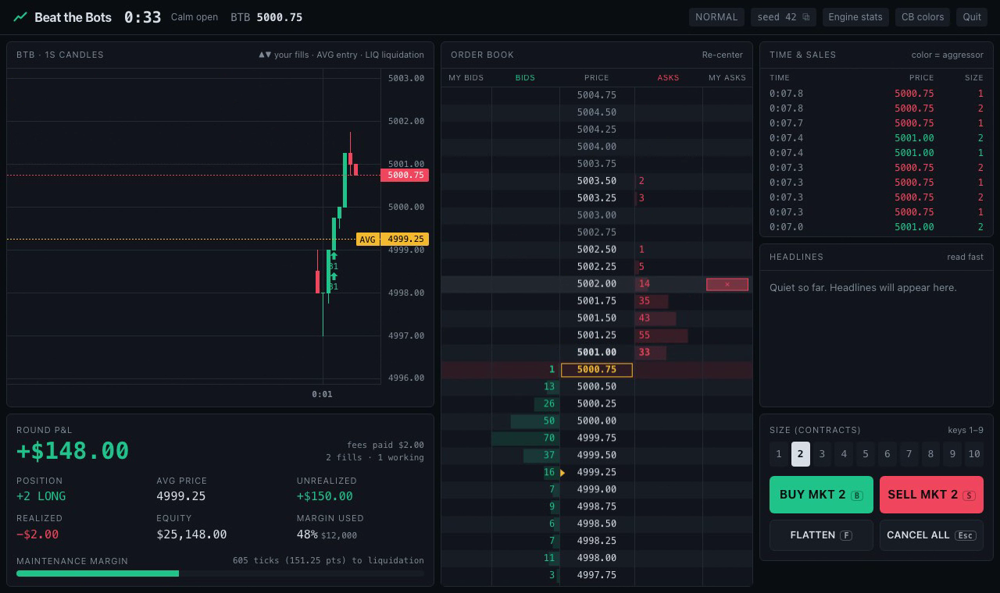

# trading_arena

## [Beat the Bots](beat-the-bots/)

A browser futures-trading game: you trade a simulated E-mini-style contract against 32 AI bots on a live exchange. The matching engine, bots and risk engine are C++20 compiled to WebAssembly, all client-side.

**▶ [Play it in your browser](https://ananmays.github.io/trading_arena/)** · [Vercel mirror](https://beat-the-bots-ten.vercel.app)

- Price-time order book benchmarked at 10–55M ops/s natively, with no allocation on the hot path
- Integer-only engine: exact zero-sum accounting, deterministic seeds, native and WASM output byte-identical
- Market makers, momentum, mean-reversion, noise and informed bots; news shocks, margin calls, liquidation

Read the full write-up, architecture, benchmarks and build instructions in [beat-the-bots/README.md](beat-the-bots/README.md).
