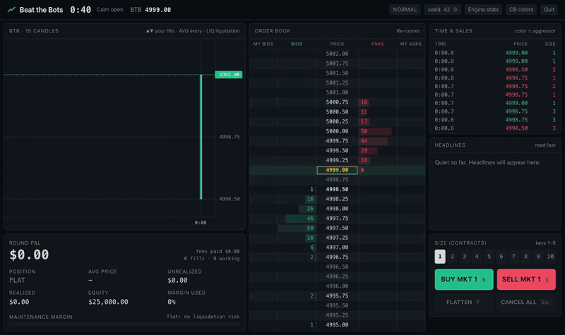
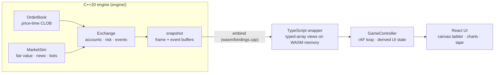

# Beat the Bots

**Trade a futures contract against 32 trading bots, in your browser.** The exchange, the bots and the risk engine are a C++20 matching engine compiled to WebAssembly; everything runs client-side, with no server.

**▶ Play:** [ananmays.github.io/trading_arena](https://ananmays.github.io/trading_arena/) · **Source:** this folder



You get a $25,000 account and five minutes. Market makers quote the book, momentum traders chase moves, mean-reversion traders fade them, noise traders add liquidity, and one informed trader can see where the price is really going. Headlines land a moment before the market digests them: read fast, trade the order book, and don't get liquidated. When the clock runs out the contract cash-settles and the end screen shows why: the hidden fair value plotted against the traded price, every headline on the charts, how your fills compared with fair value, results per bot type, and a sped-up replay of your round. Every round is a seed, so a link like `?seed=4242&diff=hard` replays the exact same market for anyone.

## Architecture



| Layer | Responsibility |
|---|---|
| `engine/src/order_book.cpp` | Price-time priority matching: limit, market, IOC, cancel, cancel-all, self-trade prevention. |
| `engine/src/exchange.cpp` | Positions and P&L, pre-trade risk, stop orders, liquidation, VWAP settlement, 48-byte event stream. |
| `engine/src/market_sim.cpp` | Deterministic tick loop: hidden fair value, news schedule, bots, round lifecycle, replay. |
| `engine/src/bots.cpp` | Market maker, momentum, mean reversion, noise and informed trader. |
| `engine/wasm/bindings.cpp` | embind only: one `Engine` class, pointers to the frame and event buffers. No game logic. |
| `web/src/engine/` | Typed wrapper; reads the snapshot and events straight out of WASM memory. |
| `web/src/game/`, `web/src/components/` | Rendering and input. The frontend never decides anything about the market. |

Each animation frame makes two calls into WASM: `step(ms)`, then `refresh()`. `refresh()` writes a flat int64 snapshot (top 20 levels per side, account, working orders and stops) and drains the event ring into a preallocated array. TypeScript reads both through typed-array views, so the boundary cost does not grow with the size of the book. Engine work is about 0.03 ms per frame, so it runs on the main thread inside `requestAnimationFrame`; a Web Worker would only add latency.

## Design decisions

**Integer ticks and cents, everywhere.** Prices are `int64` ticks (0.25 points), money is `int64` cents. P&L is exact: an account stores `cash_ticks` (Σ −qty·price over fills) and `open_cost`, so total P&L at any mark is `(cash_ticks + position·mark)·$12.50 − fees` with no rounding. Dollars only appear in `web/src/engine/format.ts`.

**No floating point in the engine at all.** The fair-value random walk, its stochastic volatility and the Gaussian sampler (Irwin–Hall over 16-bit uniforms) are 16.16 fixed point. The payoff is cross-platform determinism by construction. FMA contraction and libm differences can't make the native and WASM builds disagree.

**Determinism.** One seed is split (splitmix64) into independent xoshiro256\*\* streams for fair value, news, scheduling and each bot. The UI advances wall-clock milliseconds, but the engine only moves in whole 25 ms ticks, and every player action is stamped with the tick count it happened after. `MarketSim::replay(seed, config, actions)` reproduces the event stream exactly; the end screen's "Watch replay" builds a replay `MarketSim` from the same log and plays it at 4x or 8x. The hidden fair-value series only leaves the engine in the summary, once the round is settled. Every event is folded into a running FNV-1a hash; CI checks that `btb_cli --selftest` (native) and `web/scripts/determinism.mjs` (WASM) print identical hashes for 12 scripted rounds (market, limit and stop orders, cancels, flattens).

**Zero-sum, enforced.** Every fill adds −q·x to the buyer's cash and +q·x to the seller's, so Σ P&L + Σ fees = 0 and net open interest = 0 at every instant. A property test checks this after every single operation across 25 seeds × 10,000 random operations (including liquidations), and again after every tick of 30 full rounds over every difficulty and scenario.

**No allocation on the hot path.** Orders live in a preallocated pool with a free list; price levels are a contiguous array indexed by tick offset (re-centred if prices drift out of the window), each an intrusive FIFO linked by 32-bit pool indices. One bitset per side finds the next best price with `countl_zero`/`countr_zero`. Order ids map to pool slots through an open-addressing hash map with backward-shift deletion (no tombstones).

**Risk.** Pre-trade checks use worst-case exposure (position plus every resting order on one side): max 10 contracts, $6,000 initial margin per contract, a ±50-point fat-finger band, and player market orders become band-limited IOCs (market protection). Orders that reduce exposure are always allowed. If equity falls below $5,000 × |position|, the exchange emits a margin call, pulls the player's orders and liquidates at market, retrying if the book can't absorb it. Settlement is the VWAP of the final 10 seconds.

**Stop orders.** A stop-market (`OrderType::Stop`, price = trigger) is held by the exchange, not the book, so it is invisible to the bots and never provides liquidity. A sell stop fires when the last trade is at or below its trigger, a buy stop at or above; it is then submitted as an ordinary market order, so it gets the same risk checks and price-band protection as a click on BUY/SELL MKT. After a news gap it fills wherever the market is, not at the trigger. Triggers are evaluated at two fixed points outside the matching loop: at the end of every accepted order (after matching, before the margin check) and once per tick after the bots act. Stops are checked oldest first and the scan restarts after each one fires, so cascades resolve completely and the event stream stays deterministic. A stop the last trade has already reached is rejected (it would fire immediately; usually a click on the wrong side of the ladder). Cancel, cancel-all, flatten, liquidation and expiry all remove stops. Stops do **not** count toward worst-case exposure: they can't fill until they trigger, and the triggered order is risk-checked against the account as it is then. Counting them up front would double-count the usual bracket (take-profit limit plus protective stop) and refuse protective stops exactly when the account is fullest. Up to 16 working stops per account.

## How the bots work

The hidden **fair value** follows a fixed-point random walk with mean-reverting volatility. The regime is calm at the open, normal mid-round and hot into expiry. Headlines move it. Bots only see public data (book, trades, headlines) except the informed trader.

- **Market makers** quote four levels a side around an estimate that learns from the tape (Kyle-style: each contract of net aggressive buying lifts it by a fraction of a tick). They skew quotes against inventory, widen with realised volatility and after fast moves, and are post-only. On a headline they pull their quotes, wait until the market digests the news, then reprice by its impact and sweep stale orders. They ignore their own trades and news-driven flow when learning, so they don't chase each other into a crash.
- **Informed trader** sees fair value with a persistent error and trades toward it with protected IOCs, harder when the gap is large. Once the price catches up it works its position down passively, so its flow carries information instead of just inventory.
- **Momentum traders** chase moves over a 3-second lookback and bail when the move reverses.
- **Mean-reversion traders** fade deviations from a 30-second average with passive orders at the touch.
- **Noise traders** post small random orders near the mark with random lifetimes, sometimes cross the spread, and some pull their orders on big news.

**Difficulty** changes how much warning a headline gives before the market digests it (≈2 s on Easy, ≈1 s on Normal, almost none on Hard), plus volatility, maker spreads and how sharp the informed trader is. **Scenarios** are preset seeds: *Flash Crash* (a scripted 45-point air pocket, makers step back; goal: survive without liquidation), *Short Squeeze* (a rolling series of covering headlines), *Thin Liquidity* (two makers, one-lot quotes) and *News Day* (14 headlines).

In headless runs (`btb_cli`), the traded price stays within 2–4 ticks of the hidden fair value on average across difficulties and scenarios, while market makers roughly earn their spread and noise traders pay it.

## Benchmarks

Apple M2, Release build (`-O3`), single thread. Throughput from Google Benchmark (`btb_bench`):

| Benchmark | Throughput |
|---|---:|
| Add passive limit order | 21.0 M orders/s |
| Cancel by id (random queue position) | 54.6 M/s |
| Market order filling one resting order | 52.1 M/s |
| Market order sweeping 10 price levels | 8.4 M/s |
| Mixed steady state (55% add / 35% cancel / 10% market) | 10.4 M ops/s |

Latency (`btb_latency`; the Apple timer ticks every 41.7 ns, so ops are timed in batches of 32 and percentiles are over per-op batch averages):

| Operation | mean ns/op | p50 ns/op | p99 ns/op |
|---|---:|---:|---:|
| Add (passive limit) | 56.4 | 46.9 | 317.7 |
| Cancel | 11.6 | 10.4 | 20.8 |
| Match (1 level) | 15.5 | 14.3 | 26.0 |
| Mixed (55/35/10) | 58.5 | 52.1 | 178.4 |

A full 5-minute round with 32 bots (≈86k orders and cancels) simulates in about 12 ms natively, roughly 25,000× real time. In the browser the engine costs ≈0.03 ms per frame. The whole production site is ≈200 KB gzipped (42 KB of it the WASM module), against a 2 MB budget.

## Testing

```text
engine/tests/   Catch2: matching (priority, partial fills, sweeps, IOC, market, cancels, STP,
                rejects, re-centring, randomised conservation), flat map vs std::unordered_map,
                accounting, risk rejects, liquidation and retry, settlement, event fields,
                zero-sum property test, stops (trigger direction, gap-through, rejects,
                cancel/cancel-all/flatten/liquidation/expiry, risk at trigger, cascades,
                zero-sum with stops, replay with stops), fair value, news schedule, config parsing,
                determinism (same seed, frame-rate independence, action-log replay),
                full-round zero-sum over every difficulty × scenario, flash-crash liquidation
web/tests/      Vitest: candles, share links, formatting, leaderboard (incl. broken storage),
                components (PositionPanel, Controls, Landing), and the real WASM module
                through the TypeScript wrapper (frame/event ABI, stops)
web/e2e/        Playwright: load → tutorial → trade within 10 s → place and cancel an order
                and a stop on the ladder → hotkeys → end screen; plus a run with
                localStorage disabled
```

CI (`.github/workflows/ci.yml` at the repo root) builds the engine with Clang (`-Werror`) and GCC, runs the tests, the headless round and benchmark smoke runs, and checks native vs WASM determinism for both the committed and a freshly built module. It then runs Vitest, enforces a 2 MB gzipped size budget, and runs Playwright.

## Build it yourself

Prerequisites: CMake ≥ 3.24, a C++20 compiler, Ninja, Node ≥ 20, and Emscripten (only to rebuild the WASM module).

```bash
# native engine, tests, benchmarks, headless round
cmake -S engine -B engine/build -G Ninja -DCMAKE_BUILD_TYPE=Release
cmake --build engine/build
ctest --test-dir engine/build
engine/build/btb_cli --seed 42 --difficulty hard --player random --headlines
engine/build/btb_bench && engine/build/btb_latency

# WebAssembly module (copied into web/src/engine/wasm/)
./scripts/build_wasm.sh

# web app
cd web && npm install
npm run dev          # http://localhost:5173
npm test             # vitest
npm run e2e          # playwright (npx playwright install chromium first)
npm run determinism  # WASM determinism hashes; compare with engine/build/btb_cli --selftest
```

The compiled WASM module is committed, so the web app builds anywhere without Emscripten (that's what lets a static host build it). CI rebuilds it from source and checks it against the native engine.

URL parameters: `seed`, `diff` (`easy|normal|hard`), `scenario` (`flash_crash|short_squeeze|thin_liquidity|news_day`), and `t` (round length in seconds, 15–3600; used by the tests).

## Deploying

The site is a static Vite build. It is live on GitHub Pages: `.github/workflows/pages.yml` builds `web/` with `--base=/trading_arena/` and publishes it on every push to `main` that touches `web/`.

To host it on Vercel instead: import the GitHub repo, set **Root Directory** to `beat-the-bots/web` (framework: Vite, build `npm run build`, output `dist`; `web/vercel.json` already sets these and long-lived caching for hashed assets). Every push to `main` redeploys.

## Controls

| Key | Action |
|---|---|
| `B` / `S` | Buy / sell at market (selected size) |
| `F` | Flatten: cancel all and close the position |
| `Esc` | Cancel all working orders |
| `1`–`9` | Order size |
| Click ladder | Bid side buys at that price, ask side sells; click your own order or stop to cancel it |
| `Shift`-click ladder | Stop order: bid side above the market = buy stop, ask side below = sell stop |
| **STOP** (ladder header) | Stop mode: plain clicks and taps place stops (for touch screens) |
